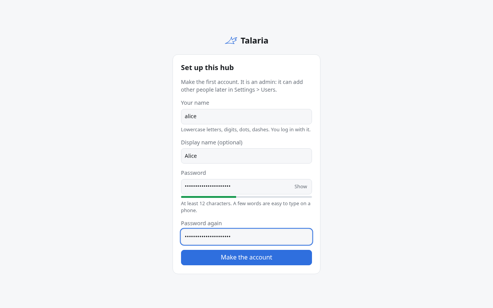

# Install with Docker Compose

This page takes you from a Linux host with Docker to your first chat in Talaria. It starts three parts: the hub
(the web app), Hermes (the agent) and a sandbox (where the agent runs commands), plus a small web front and a
built-in login. Every secret is made for you on the first start.

## What you need

- A Linux host with Docker Engine 24 or newer and the Compose plugin 2.24 or newer (`docker compose version`).
  Docker Desktop on macOS or Windows works too. To install Docker on Linux:

  ```bash
  curl -fsSL https://get.docker.com | sudo sh
  sudo usermod -aG docker "$USER"
  ```

  then log out and back in, so that `docker` works without `sudo`.
- 2 GB of free RAM and 10 GB of free disk. The Hermes image alone is about 1.1 GB to download.
- A model provider that Hermes supports: an API key or sign-in (OpenRouter, Nous Portal, OpenAI, Anthropic, and
  many others), or Ollama for local models. To try Talaria first, use the demo model: it needs no key, but it only
  answers with a canned reply.

## Step 1: Get the files

```bash
mkdir talaria && cd talaria
curl -fsSL https://github.com/USA-RedDragon/talaria/archive/refs/heads/main.tar.gz \
  | tar -xz --strip-components=3 talaria-main/deploy/compose
cp .env.example .env
```

You now have `compose.yaml`, `.env` and a `files` folder.

## Step 2: Start Talaria

```bash
docker compose up -d --wait
```

The first start downloads the images (about 1.2 GB, mostly the Hermes image) and then takes under a minute:
`--wait` returns when every part is healthy. On the test VM, with the Hermes image already there, this step
took 26 seconds.

## Step 3: Make your account

```bash
docker compose logs init
```

shows the address:

```text
 Open:  http://localhost:8080
```

Open it in a browser on the same host. While Talaria has no account, it shows the setup page: give a user name, a
display name and a password of at least 12 characters. The first person who does this becomes the admin, so do it
right away, before Talaria is reachable from other machines. There is no password in the log.



Add other people later under Settings, Users (see [Set up logins](auth.md)). Before the first chat, Hermes needs a
model (step 4). With the demo model, the reply starts with "This is the Talaria demo model". A few messages show
more:

- `run: uname -a`: the agent runs the command in the sandbox. A risky command, such as `run: rm -rf /work/old`,
  asks for your approval first.
- `page:`: the reply has a small page with buttons that answer back to the chat.
- `remember: <a fact>` saves it to memory; then, in a new chat, `recall: <a word of it>` shows that the memory
  came back (with Honcho on, from Honcho too).

To open Talaria from another computer, see [Reach it from other computers](#reach-it-from-other-computers).

## Step 4: Pick a model in Hermes

The model and provider are Hermes settings. Run Hermes's setup wizard in its container:

```bash
docker compose exec -u hermes hermes hermes model
```

Pick a provider with the arrow keys, give it what it asks for (an API key, a sign-in, or an address), then the
model. New chats use it at once. [Choosing models and providers](models.md) has the details, Ollama included.

To look around without any provider first, start the demo model (`COMPOSE_PROFILES=demo` in `.env`, then
`docker compose up -d --wait`) and pick `talaria-demo` in `hermes model`.

## Reach it from other computers

The hub accepts requests only for the address in `TALARIA_PUBLIC_URL`. By default that is
`http://localhost:<TALARIA_PORT>`, which works only on the host itself.

- **On a LAN, without HTTPS:** set `TALARIA_PUBLIC_URL=http://<host address>:8080` and run
  `docker compose up -d`. Chats work. Pages and push notifications need HTTPS, so they do not.
- **With HTTPS from Caddy (a domain that points at this host, ports 80 and 443 open):** set
  `TALARIA_PUBLIC_URL=https://talaria.example.com` and `TALARIA_SITE=talaria.example.com`, and publish ports 80
  and 443 with a `compose.override.yaml`:

  ```yaml
  services:
    front:
      ports: !override
        - "80:80"
        - "443:443"
  ```

- **With HTTPS on a LAN or for a test (no public domain):** set `TALARIA_TLS=internal` as well. Caddy then makes
  its own certificate authority. Browsers, phones and computers that you pair must trust its root certificate:

  ```bash
  docker compose cp front:/data/caddy/pki/authorities/local/root.crt talaria-root.crt
  ```

  Import `talaria-root.crt` as a trusted authority in the browser or the system (on Debian and Ubuntu: copy it to
  `/usr/local/share/ca-certificates/` and run `sudo update-ca-certificates`). The name in `TALARIA_SITE` must
  resolve to this host on every device, through your DNS or each device's hosts file.
- **Behind your own reverse proxy:** proxy to port 8080 of the host and set `TALARIA_PUBLIC_URL` to the
  proxy's address. Turn off response buffering (chats stream as server-sent events) and allow WebSockets on
  `/api/device/`. To let the proxy log people in (Authelia, oauth2-proxy), see
  [Set up logins](auth.md#behind-a-reverse-proxy).

## Settings

All settings are in `.env`. Every one is listed, with its comment, in the [settings reference](reference.md#compose-settings-env).

After a change, run `docker compose up -d`. The `init` service writes the configs again from `.env` on every
start; it never changes a secret it made.

## What runs

| Service | What it does |
| ------- | ------------ |
| `init` | Makes the secrets once, writes the hub config, prints the address, then exits |
| `plugin` | Copies the Talaria device plugin out of its image, then exits |
| `hermes-init` | Sets up the Hermes home: plugin, hub key, Talaria settings in `config.yaml`, then exits |
| `hermes` | Hermes Agent, the agent itself |
| `front` | Caddy: the one published port, in front of the hub (and HTTPS when `TALARIA_SITE` is set) |
| `hub` | The Talaria hub: web app, Telegram bot, device connections |
| `sandbox` | Runs the agent's commands for chats that are not on one of your computers |
| `demo-llm` | The demo model (profile `demo`) |

Data lives in Docker volumes: `talaria_hermes-data` (chats, memory, Hermes settings), `talaria_hub-data`,
`talaria_sandbox-work` (the sandbox's files), `talaria_secrets`. See [Upgrades and backups](upgrades.md).

## Add your computers

Install `talaria` on each computer you want the agent to work on, and pair it with your hub. See the
[Add a computer](../start/add-a-computer.md) page. Give `talaria setup` your hub's address
(`TALARIA_PUBLIC_URL`).

## Troubleshooting

- `docker compose up` says `pull access denied`: every image is public, so check the image names in `.env`
  (`TALARIA_HERMES_IMAGE`) and that the host reaches ghcr.io. See [Images](images.md).
- `docker compose ps -a` shows every service and why one stopped; `docker compose logs <service>` shows its log.
- The login page says the address is wrong, or the hub log shows `oidc discovery ... connection refused`:
  `TALARIA_PUBLIC_URL` does not match how you open Talaria. Use the same address in both, then
  `docker compose up -d`.
- Start over (deletes all chats and settings): `docker compose down -v`.
