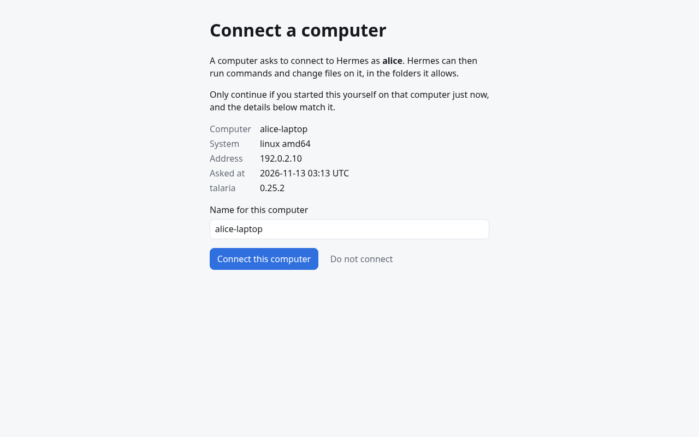
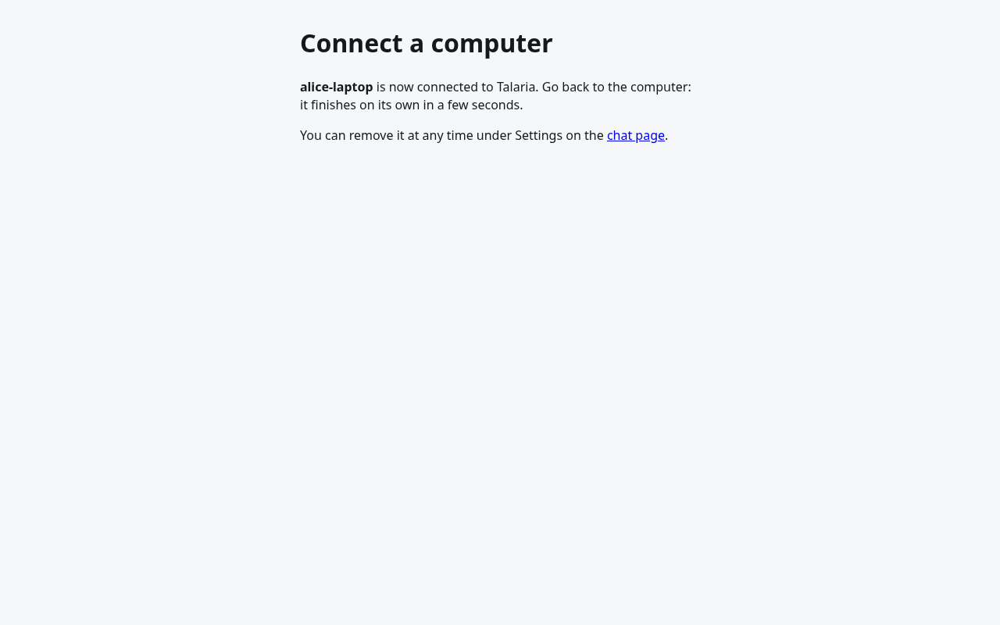
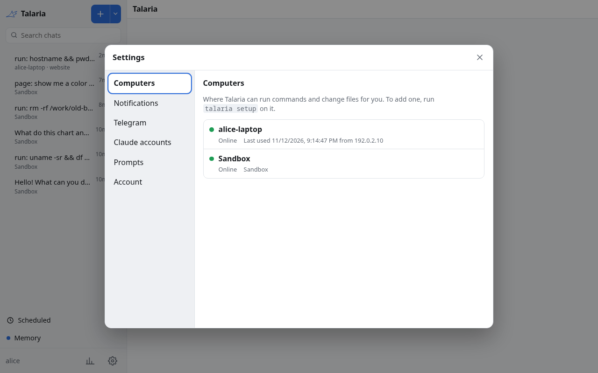
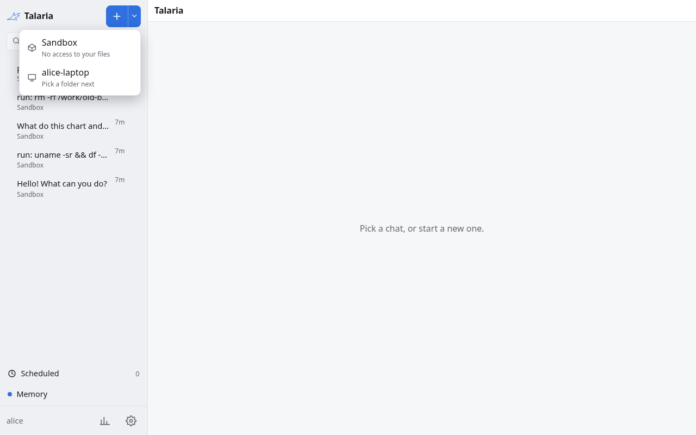
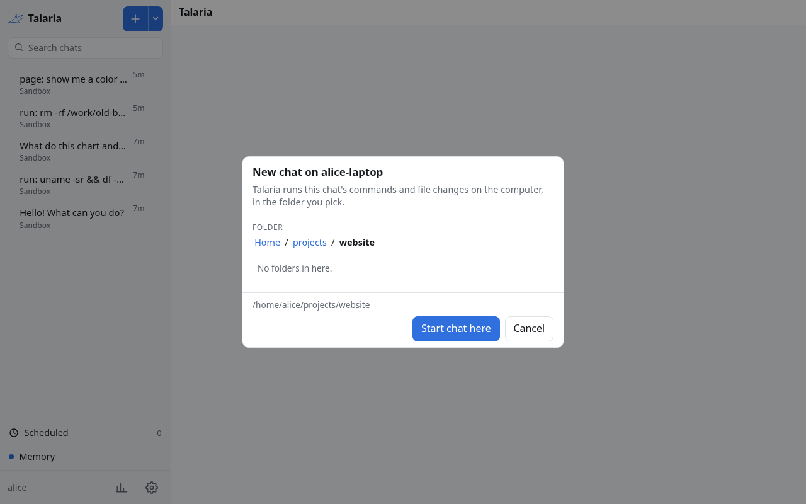
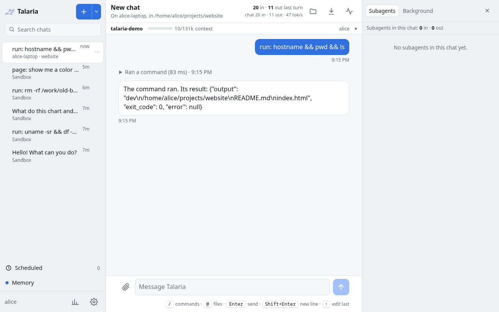

# Adding your computers

By default the agent runs its commands in the sandbox on the server. To let it work on your own files and programs, install the `talaria` program on your computer and pair it with your hub. After that you choose, per chat, whether the agent works in the sandbox or on that computer, in a folder you pick.

The computer connects out to the hub over HTTPS. You do not open any port on the computer.

## Before you start

- Your hub must be reachable from the computer at its public address (`TALARIA_PUBLIC_URL`, or `publicUrl` in Helm), for example `https://talaria.example.com`. For a try-out on one machine, `http://localhost:8080` works from that machine only.
- You need your hub login.
- The computer runs Linux or macOS. Windows is not supported.

## Pair a computer

1. Download `talaria` for your system from the [latest release](https://github.com/USA-RedDragon/talaria/releases/latest) and unpack it. The [install page](https://github.com/USA-RedDragon/talaria/blob/main/docs/start/install.md) has the details for each system.
2. Run setup with your hub's address:

   ```sh
   ./talaria setup https://talaria.example.com
   ```

3. Setup prints a link and a code. Open the link, log in to the hub and type the code. The hub then shows what is asking to connect: the computer's name, its system, its address and the time. Check that they match the computer in front of you, name it, and choose "Connect this computer".

   

   The page then says the computer is connected, and setup finishes on the computer within a few seconds.

   
4. Setup finishes: it starts a background service, writes `~/.config/talaria/config.yaml` and, if you use Firefox, offers to connect it.

In the hub, open Settings and then Computers. The new computer shows as online, next to the Sandbox.



## Use it

- In a chat, use the arrow next to the plus button to start a chat on a computer, then pick a folder. Or use `/device` in an existing chat to move it.

  

  

  The chat's header then says where it runs, and the agent's commands run there:

  
- On Telegram, `/devices` lists your computers and `/new NAME [folder]` starts a chat on one.
- From a terminal on that computer, `talaria chat` opens the agent in the current folder.

A chat that was ever tied to a computer never falls back to the server. If the computer goes offline, its messages fail until it is back.

## Safety

- The agent runs commands as your user, on the folders you allow. By default that is your home directory. Narrow it with `device.roots` in `~/.config/talaria/config.yaml`.
- Each command has a memory cap on Linux with systemd.
- The agent asks before it does anything you cannot undo in Firefox: see [Let the agent use Firefox](https://github.com/USA-RedDragon/talaria/blob/main/docs/guides/browser-extension.md).
- To cut a computer off, remove it in Settings, Computers. Its token stops working at once.

## Your hub is not on the public internet

The computer must reach the hub. Put the hub behind a VPN you already use (Tailscale, WireGuard) or a tunnel, and use that address as the public URL everywhere. A computer on the same LAN can use `http://<host>:8080` if you set `TALARIA_PUBLIC_URL` to that, but then pages and push notifications do not work, because they need HTTPS.

## More

The `talaria` repository has the full guides: [install](https://github.com/USA-RedDragon/talaria/blob/main/docs/start/install.md), [pairing](https://github.com/USA-RedDragon/talaria/blob/main/docs/start/setup-and-pairing.md), [Firefox control](https://github.com/USA-RedDragon/talaria/blob/main/docs/guides/browser-extension.md), [editors](https://github.com/USA-RedDragon/talaria/blob/main/docs/guides/editor-bridge.md) and [troubleshooting](https://github.com/USA-RedDragon/talaria/blob/main/docs/guides/troubleshooting.md).
