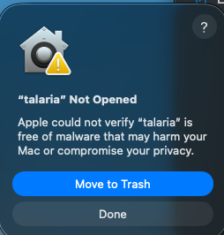
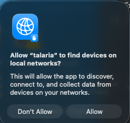
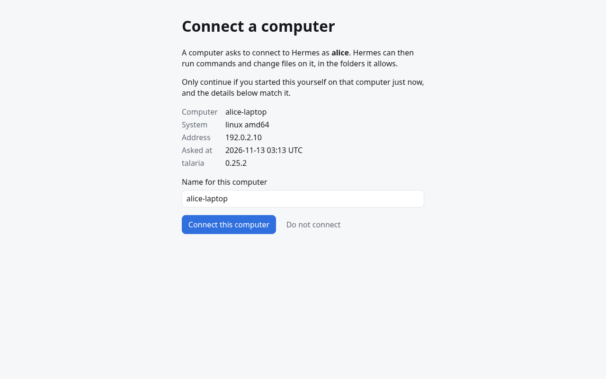
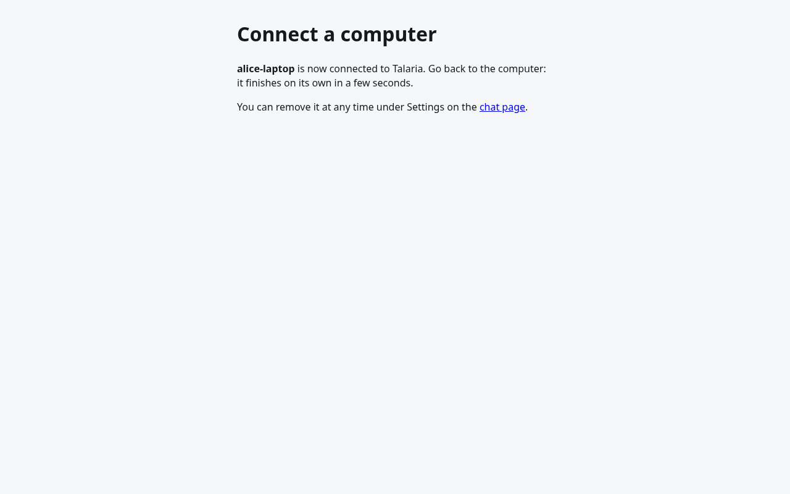
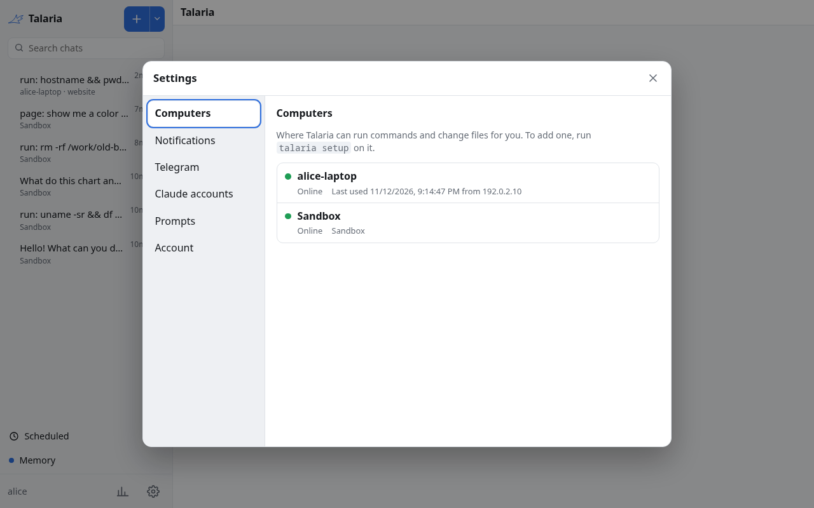
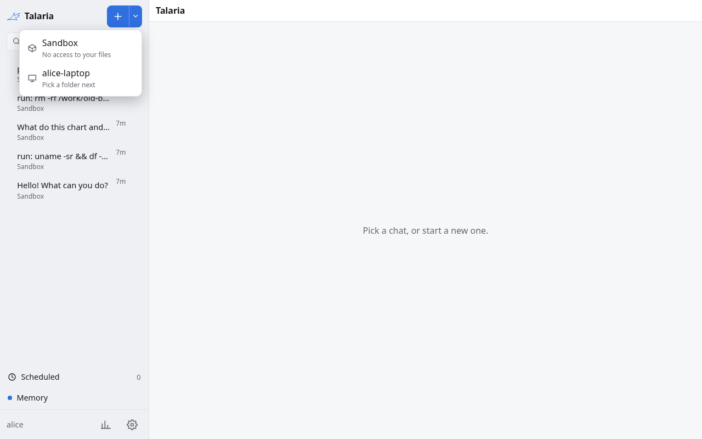
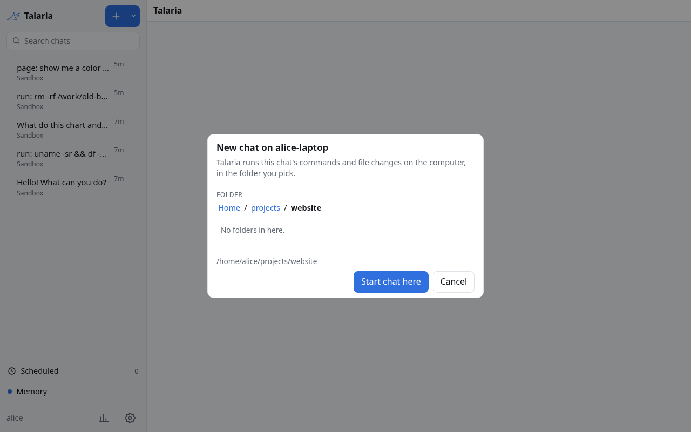
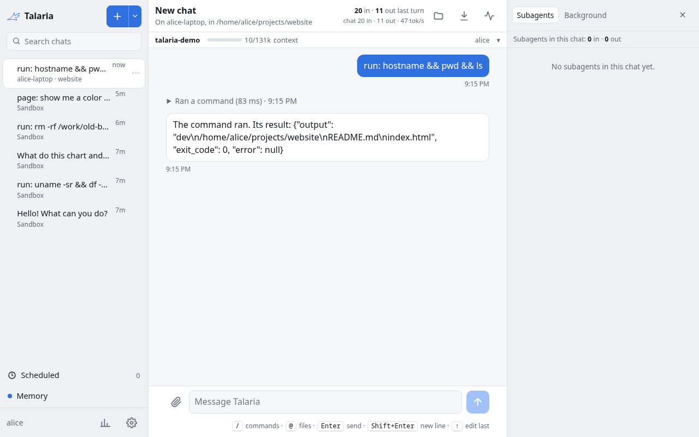

# Add a computer

By default the agent runs its commands in the sandbox on the server. To let it work on your own files and programs, install the `talaria` program on your computer and pair it with your hub. After that you choose, per chat, whether the agent works in the sandbox or on that computer, in a folder you pick. The same program also lets the agent use your Firefox, and lets you chat with the agent from a terminal or an editor.

The computer connects out to the hub over HTTPS. You do not open any port on the computer.

## Before you start

- You need a Talaria hub: see [Pick an install](../deploy/getting-started.md) to run your own.
- The hub must be reachable from the computer at its public address (`TALARIA_PUBLIC_URL`, or `publicUrl` in Helm), for example `https://hub.example.com`. For a try-out on one machine, `http://localhost:8080` works from that machine only.
- You need an account on the hub.
- The computer must run Linux or macOS:

| System | Status |
|---|---|
| Linux, amd64, arm64, armv6, armv7, riscv64 | Supported. The background service needs a systemd user manager. |
| macOS, Intel and Apple silicon | Supported. The background service is a launchd agent. |
| Windows | Not supported. Device paths must be POSIX paths. |

Two features have more limits:

- **Chat from a terminal** (`talaria chat`) runs the same Hermes build as your server on Linux with glibc 2.28 or newer. On macOS it runs a Hermes that you installed yourself, and it must be the same release as the server's.
- **Firefox control** needs Firefox 139 or newer from your distribution or from Mozilla. The Flatpak build of Firefox cannot reach the program that the extension talks to, and the Snap build is untested and likely has the same problem, so use another build.

## Download the program

1. Open the [latest release](https://github.com/USA-RedDragon/talaria/releases/latest) and download `talaria_<version>_<os>_<arch>.tar.gz` for your system. `<os>` is `linux` or `darwin`, and `<arch>` is `amd64`, `arm64`, `armv6`, `armv7` or `riscv64`.
2. Check the download. Every release since <!-- docgen:const pkg=internal/setup name=FirstAttestedVersion code=false -->0.13.0<!-- /docgen:const --> has a signed build record that proves which workflow built the file. With the [GitHub CLI](https://cli.github.com):

   ```sh
   gh attestation verify talaria_<version>_linux_amd64.tar.gz --repo USA-RedDragon/talaria
   ```

   [Releases and verification](../releases.md) explains this and the SHA-256 check by hand.
3. Unpack it:

   ```sh
   tar -xzf talaria_<version>_linux_amd64.tar.gz
   ```

## Run setup

`talaria setup` does everything in one run: it installs the program, pairs the computer with your hub, writes a config file, starts the background service and connects Firefox. It only does the steps that are not done yet, so you can run it again at any time. The hub address is required. A release does not know any hub by itself, so without the address setup stops with `give the hub URL`.

On Linux, run the unpacked program once. It installs itself under `~/.talaria/bin` and does the rest:

```sh
./talaria setup https://hub.example.com
```

### On macOS

The program is not signed with an Apple Developer ID and not notarized by Apple. What happens on the first run depends on how you downloaded it:

- **With `curl` in Terminal**, macOS does not mark the file, and it runs at once. This is the simplest way (use `darwin_amd64` on an Intel Mac):

  ```sh
  V=<version>   # for example 0.25.4, without the v
  curl -fsSLO https://github.com/USA-RedDragon/talaria/releases/download/v$V/talaria_${V}_darwin_arm64.tar.gz
  curl -fsSLO https://github.com/USA-RedDragon/talaria/releases/download/v$V/talaria_${V}_checksums.txt
  grep talaria_${V}_darwin_arm64 talaria_${V}_checksums.txt | shasum -a 256 -c -
  tar -xzf talaria_${V}_darwin_arm64.tar.gz
  ./talaria setup https://hub.example.com
  ```

- **With a browser**, macOS marks the archive as downloaded from the internet, and `tar` passes the mark on to `talaria`. Clear the mark before you run it the first time:

  ```sh
  xattr -d com.apple.quarantine ./talaria
  ./talaria setup https://hub.example.com
  ```

  If you run it with the mark, macOS refuses it with "talaria" Not Opened. In Terminal the command then just waits with no output; press Ctrl-C.

  

  Choose Done. Clearing the mark on that same file afterwards was not enough in our test on macOS 26: unpack the archive again, then run `xattr -d` on the new file before its first run. The other way is System Settings, Privacy & Security, "Open Anyway".

The macOS service is a launchd agent, `~/Library/LaunchAgents/io.github.usa-reddragon.talaria.plist`, and its log is `~/Library/Logs/talaria.log`. macOS shows a notification that a login item was added; that is this agent, and it is listed under System Settings, General, Login Items & Extensions.

**A hub on your local network.** If the hub address is a LAN address (such as `http://192.168.1.10:8080`), macOS asks once whether talaria may use the local network:



Choose Allow. Until you do, the service cannot reach the hub and its log says `connect: no route to host`, even though `curl` to the same address works from an SSH session. If you chose Don't Allow, turn talaria on under System Settings, Privacy & Security, Local Network. A hub at a public HTTPS name or a Tailscale address is not affected.

**Setup over SSH.** You can run setup on a Mac over SSH while you are also logged in at the Mac. Setup then prints the pairing link and does not open a browser or Firefox on the Mac's screen; the Local Network question above still appears on that screen. macOS keeps the login keychain locked in SSH sessions, so:

- setup over SSH stores the token in a file readable only by you, `~/Library/Application Support/talaria/token`, instead of the Keychain;
- if setup ran in Terminal and the token is in the Keychain, commands that need it (`talaria chat`, `talaria acp`, `talaria setup --uninstall`) cannot read it over SSH and say so. Run them in Terminal on the Mac.

Setup works through these steps, in this order:

1. **Install.** The program copies itself to `~/.talaria/bin/talaria` and makes a short link, `tal`, next to it. It will not replace a newer installed release unless you pass `--force`.
2. **Pair.** It prints a link and a code and opens the link in your browser when it can (not over SSH). [Approve the pairing](#approve-the-pairing) below.
3. **Config.** It writes `~/.config/talaria/config.yaml` (on macOS `~/Library/Application Support/talaria/config.yaml`) when that file does not exist, with your hub address and `device.roots` set to your home directory. An existing file is never changed unless you pass `--overwrite-config`, and then the old one is saved first.
4. **Firefox.** When it finds Firefox, it turns browser control on and registers the native messaging host.
5. **PATH.** It checks that `~/.talaria/bin` is on your `PATH`, also for `bash -l`, because the agent runs commands with a login shell. It asks before it changes any of your shell files, and it saves a backup of each one first. When setup does not run in a terminal, it changes nothing and lists what to add.
6. **Service.** It installs and starts the daemon so that it starts when you log in: a systemd user unit on Linux, a launchd agent on macOS. The daemon connects to the hub and reconnects by itself.
7. **Extension.** If Firefox does not have the Talaria extension yet, it opens Firefox at the extension's install page. Choose "Continue to Installation", then "Add". Setup waits up to 10 minutes for the extension to connect.
8. **Summary.** It prints what it did and what is left for you. If a step failed, the summary ends with the error and the later steps did not run.

Useful options:

- `--no-service` skips the background service. `--no-browser` leaves Firefox alone. `--no-shell-check` leaves your shell files alone.
- `--name my-laptop` suggests the computer's name on the hub.
- `--bin-dir DIR` installs the program somewhere else.

The full list is in the [command line reference](../reference/cli.md#setup).

### A server you reach over SSH, or a machine with no systemd

On a headless Linux machine, the service runs while you are logged in. To keep it running after you log out and after a reboot, ask systemd to keep your user's services running:

```sh
loginctl enable-linger "$USER"
```

If the computer has no systemd user manager (Alpine, WSL without systemd, a container), setup cannot install the service and says so. Run `./talaria setup --no-service https://hub.example.com`, then start the daemon yourself with `~/.talaria/bin/talaria run`, from a process manager of your choice.

For a computer you reach only over SSH, pair once with `talaria login`, then run the daemon under your own supervisor. For a machine with no person at all, such as a sandbox, give the daemon a token with `hub.token-file` instead. Both are covered in the [configuration reference](../reference/configuration.md).

## Approve the pairing

Setup prints a link and a code:

```text
Open https://hub.example.com/device/pair
sign in, enter the code BCDF-GHJK and confirm this device.
```

Open the link, log in to the hub and type the code. The hub then shows what is asking to connect: the computer's name, its system, its address and the time. Check that they match the computer in front of you, name it, and choose "Connect this computer".



The page then says the computer is connected, and setup finishes on the computer within a few seconds, with `Paired as <name> (<id>) with backend <backend>`.



The code expires after 10 minutes by default. If it does, run `talaria login` again.

## Check that it works

On the computer, `talaria --help` should print the help. If your shell says `talaria: command not found`, `~/.talaria/bin` is not on your `PATH` yet. Setup offers to add it. Open a new terminal after you say yes, or run `~/.talaria/bin/talaria` by its full path.

In the hub, open Settings and then Computers. The new computer shows as online, next to the Sandbox, while the service runs.



To see the service itself:

```sh
systemctl --user status talaria      # Linux
journalctl --user -u talaria -f      # Linux logs
launchctl list | grep talaria        # macOS
tail -f ~/Library/Logs/talaria.log   # macOS logs
```

Then run something on it from a chat. Use the arrow next to the plus button to start a chat on a computer, then pick a folder. Or use `/device` in an existing chat to move it.





Ask the agent to run a command, such as `pwd`. The chat's header says where it runs, and the command's output comes from the computer:



Other ways to reach the computer:

- On Telegram, `/devices` lists your computers and `/new NAME [folder]` starts a chat on one.
- From a terminal on that computer, `talaria chat` opens the agent in the current folder. See [Chat from a terminal](../guides/terminal-chat.md).

A chat that was ever tied to a computer never falls back to the server. If the computer goes offline, its messages fail until it is back.

## Which folders and what the agent can do

By default the agent may run commands in your home directory and below, and nowhere else. A command whose working directory is outside the allowed folders is refused. The folders limit where commands start, not what a command does: a command can still `cd` elsewhere, and the next command in that chat is then refused until it starts in an allowed folder again. To narrow it, edit `~/.config/talaria/config.yaml` (on macOS `~/Library/Application Support/talaria/config.yaml`):

```yaml
device:
  roots:
    - /home/alice/src
    - /home/alice/notes
```

Then restart the service: `systemctl --user restart talaria` on Linux, `launchctl kickstart -k gui/$(id -u)/io.github.usa-reddragon.talaria` on macOS, or run `talaria setup` again on either. Every key is listed in the [configuration reference](../reference/configuration.md).

- The agent runs commands as your user, so it can do what you can do in the allowed folders. Treat it like a person who has your terminal.
- Each command runs with a memory cap on Linux with systemd, so a runaway command is killed and nothing else is affected. The default is 75% of the service's limit.
- The agent asks before it does anything you cannot undo in Firefox: see [Let the agent use Firefox](../guides/browser-extension.md).
- The agent cannot reach the computer when the daemon is not running.
- The computer's token stays in your system keyring (Secret Service on Linux, Keychain on macOS), or in a file readable only by you when there is no keyring (or, on macOS, when setup ran over SSH).
- To cut a computer off, remove it in Settings, Computers. Its token stops working at once.

## Firefox and editors

- [Let the agent use Firefox](../guides/browser-extension.md): the extension, what the agent can do in your browser and when it asks you.
- [Use Talaria in an editor](../guides/editor-bridge.md): `talaria acp` for VS Code, Zed and other ACP editors. The computer must be paired first.

## If your hub is not on the public internet

The computer must reach the hub. Put the hub behind a VPN you already use (Tailscale, WireGuard) or a tunnel, and use that address as the public URL everywhere. A computer on the same LAN can use `http://<host>:8080` if you set `TALARIA_PUBLIC_URL` to that, but then pages and push notifications do not work, because they need HTTPS.

## Update, move or remove a computer

[Update, move or remove a computer](../guides/update-and-remove.md) covers self-updates, moving to another hub and `talaria setup --uninstall`.

## If something goes wrong

See [Fix computer problems](../guides/troubleshooting.md): setup errors, an expired code, a computer that shows offline, refused commands and the extension.
