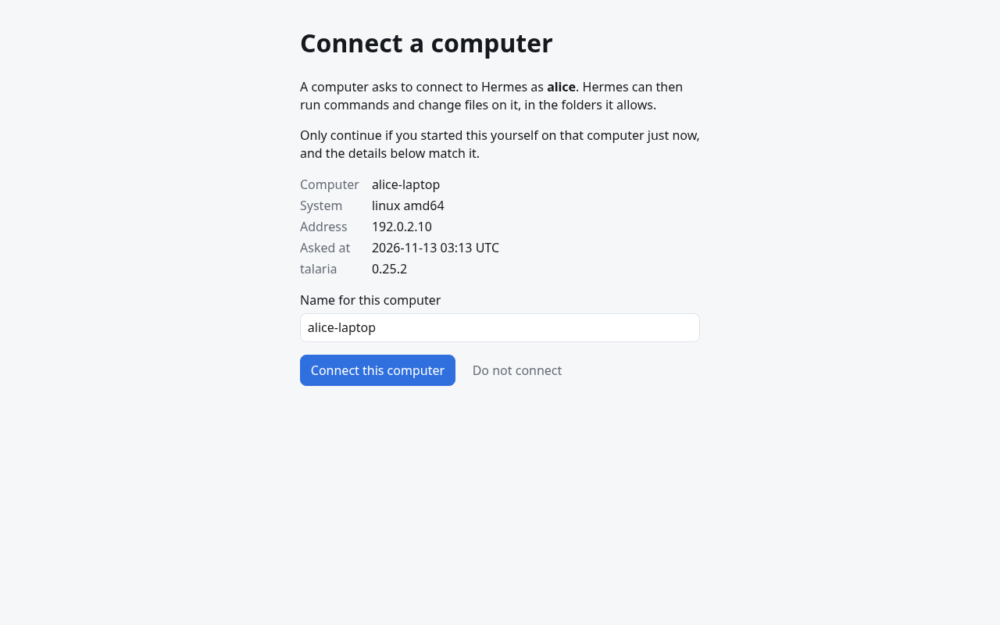
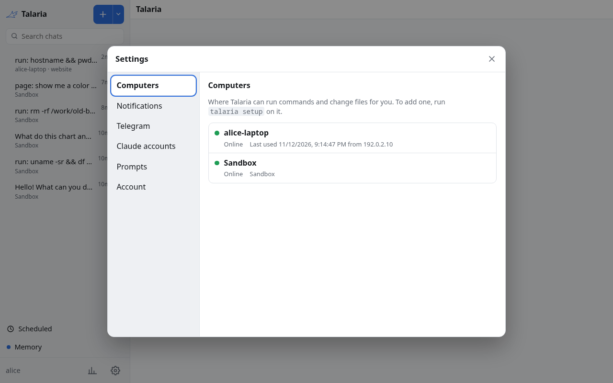

# Set up and pair a computer

`talaria setup` does everything in one run: it installs the program, pairs the computer with your hub, writes a config file, starts the background service and connects Firefox. It only does the steps that are not done yet, so you can run it again at any time.

```sh
./talaria setup https://hub.example.com
```

The hub address is required. A release does not know any hub by itself, so without the address setup stops with `give the hub URL`.

## What happens

1. **Install.** The program copies itself to `~/.talaria/bin/talaria` and makes a short link, `tal`, next to it. It will not replace a newer installed release unless you pass `--force`.
2. **Pair.** The program prints a link and a code, and opens the link in your browser when it can:

   ```text
   Open https://hub.example.com/device/pair
   sign in, enter the code BCDF-GHJK and confirm this device.
   ```

   Sign in to the hub as yourself and type the code. The hub then shows what is asking to connect: the computer's name, its system, its address and the time. Check that they match, name the computer and choose "Connect this computer".

   

   Setup then prints `Paired as <name> (<id>) with backend <backend>`. The code expires after 10 minutes by default. If it does, run `talaria login` again.
3. **Config.** It writes `~/.config/talaria/config.yaml` when that file does not exist, with your hub address and `device.roots` set to your home directory. An existing file is never changed unless you pass `--overwrite-config`, and then the old one is saved first.
4. **Firefox.** When it finds Firefox, it turns browser control on and registers the native messaging host. See [Let the agent use Firefox](../guides/browser-extension.md).
5. **PATH.** It checks that `~/.talaria/bin` is on your `PATH`, also for `bash -l`, because the agent runs commands with a login shell. It asks before it changes any of your shell files, and it saves a backup of each one first.
6. **Service.** It installs and starts the daemon so that it starts when you log in: a systemd user unit on Linux, a launchd agent on macOS. The daemon connects to the hub and reconnects by itself.
7. **Extension.** If Firefox does not have the Talaria extension yet, it opens Firefox at the extension's install page. Choose "Continue to Installation", then "Add". Setup waits up to 10 minutes for the extension to connect.
8. **Summary.** It prints what it did and what is left for you. If a step failed, the summary ends with the error and the later steps did not run.

Useful options:

- `--no-service` skips the background service. `--no-browser` leaves Firefox alone. `--no-shell-check` leaves your shell files alone.
- `--name my-laptop` suggests the computer's name on the hub.
- `--bin-dir DIR` installs the program somewhere else.

The full list is in the [command line reference](../reference/cli.md#setup).

## Which folders can the agent use

By default the agent may run commands in your home directory and below, and nowhere else. A command whose working directory is outside the allowed folders is refused. To narrow it, edit `~/.config/talaria/config.yaml`:

```yaml
device:
  roots:
    - /home/alice/src
    - /home/alice/notes
```

Then restart the service: `systemctl --user restart talaria` on Linux, or run `talaria setup` again on macOS. Every key is listed in the [configuration reference](../reference/configuration.md).

## Check the connection

Open the hub, go to Settings, then Computers. The new computer shows as online while the service runs.

 On the computer itself:

```sh
systemctl --user status talaria      # Linux
journalctl --user -u talaria -f      # Linux logs
launchctl list | grep talaria        # macOS
tail -f ~/Library/Logs/talaria.log   # macOS logs
```

In a chat on the hub, the agent can now pick this computer: use `/device` in the chat to choose it and the folder to work in.

## What the agent can and cannot do here

- It runs commands as your user, so it can do what you can do in the allowed folders. Treat it like a person who has your terminal.
- Each command runs with a memory cap on Linux with systemd, so a runaway command is killed and nothing else is affected. The default is 75% of the service's limit.
- It cannot reach this computer when the daemon is not running, and a session that was tied to a computer never falls back to running on the server.
- The computer's token stays in your system keyring (Secret Service on Linux, Keychain on macOS), or in a file readable only by you when there is no keyring.

To stop all of this at any time, remove the computer on the hub (Settings, Computers) or run `talaria setup --uninstall`. See [Update, move and remove](../guides/update-and-remove.md).

## Computers with no desktop

For a computer you reach only over SSH, pair once with `talaria login`, then run the daemon under your own supervisor. For a machine with no person at all, such as a sandbox, give the daemon a token with `hub.token-file` instead. Both are covered in the [configuration reference](../reference/configuration.md).
