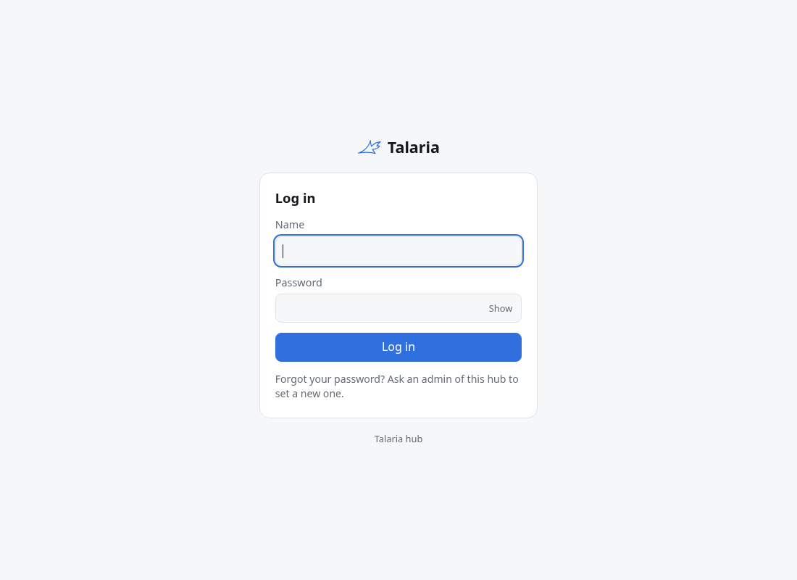
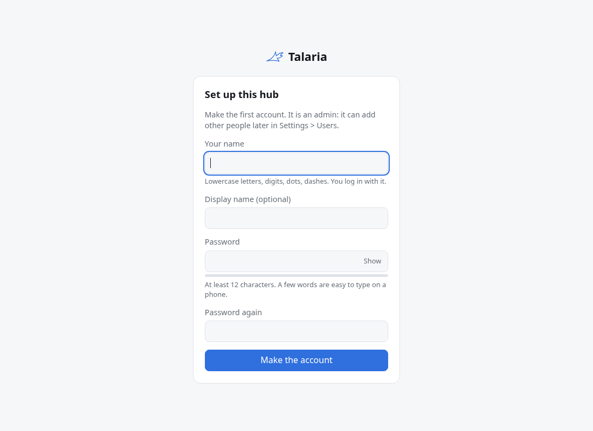
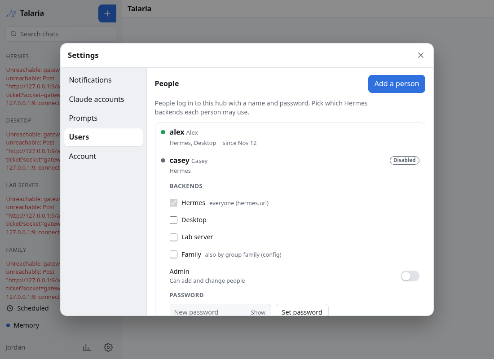
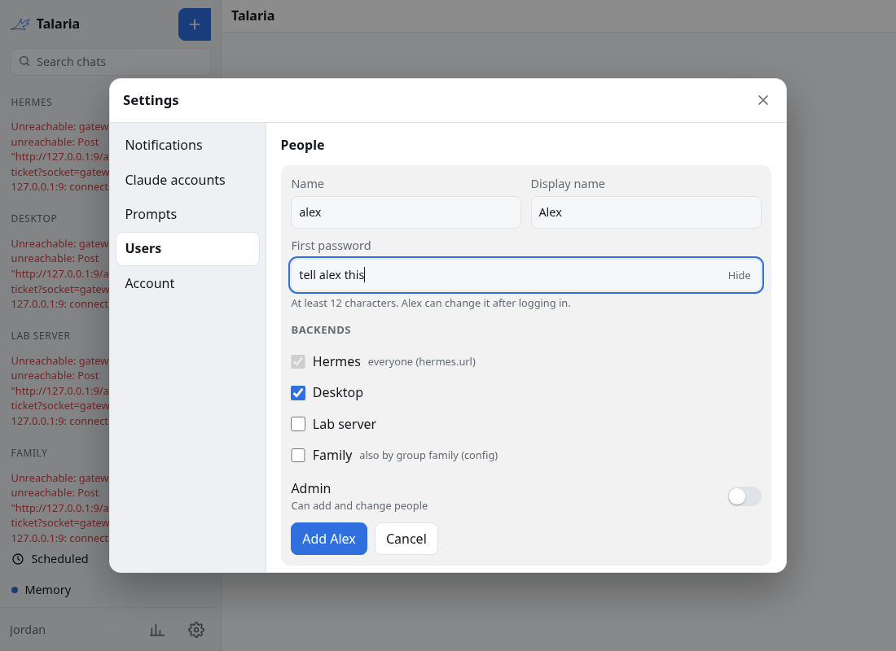
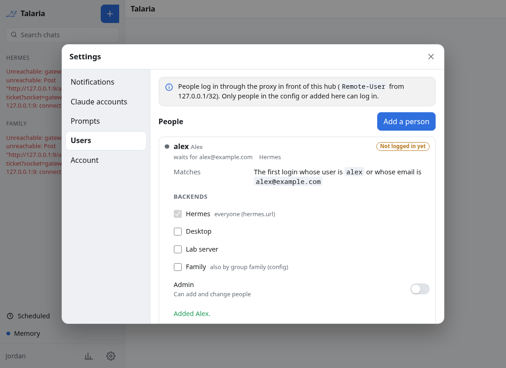
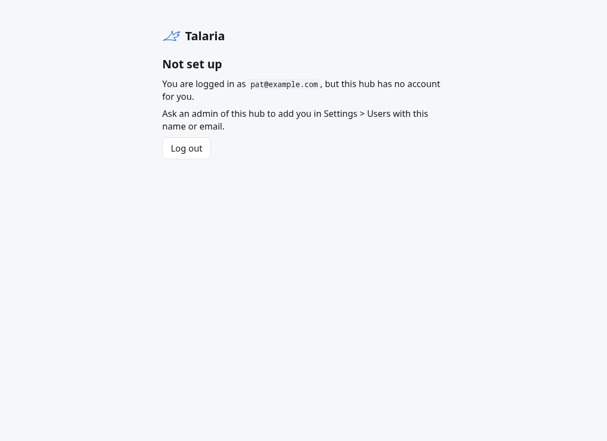
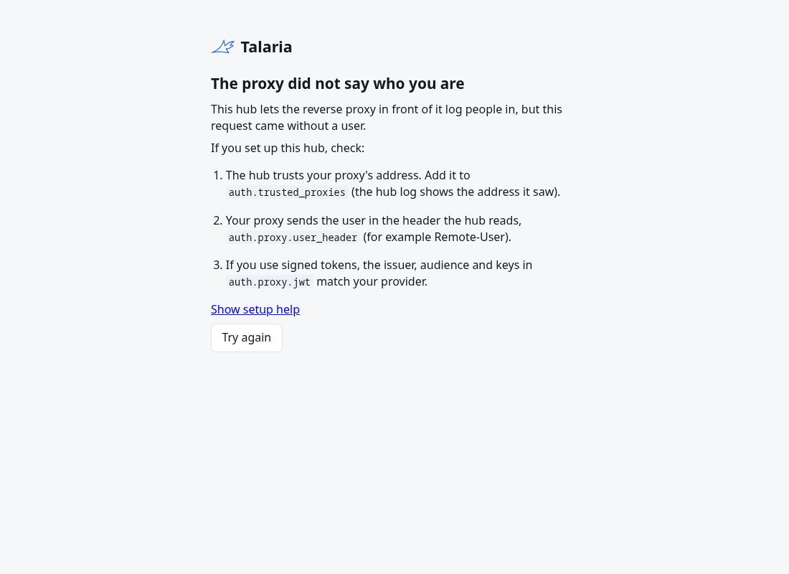

# Logging in

The hub has three ways to log people in, set by `auth.mode`:

| Mode | Who says who you are | Needs |
|---|---|---|
| `local` (the default) | The hub: accounts with passwords in its database | Nothing else |
| `proxy` | A reverse proxy in front of the hub, by a header or a signed token | A proxy that logs people in: Authelia, Authentik's proxy outpost, oauth2-proxy, tailscale serve, Cloudflare Access, Envoy Gateway |
| `oidc` | An OpenID Connect provider | Keycloak, Authentik, Authelia, Pocket ID, Google and others |

When `auth.mode` is not set, a hub with `oidc.issuer_url` uses `oidc` (so a config written before the other modes keeps working) and any other hub uses `local`.

Every mode ends in the same session cookie (`session.ttl`, default a week). `session.secret` may stay empty: the hub then makes a key and keeps it in its database, so every replica shares it and a restart keeps people logged in.

## Which mode should I use

- **Just you, or a family, and nothing else to run:** `local`. It needs no identity provider. This is the default.
- **You already log in to your other services through one proxy** (Authelia, an Authentik outpost, oauth2-proxy, Tailscale Serve, Cloudflare Access, Envoy Gateway): `proxy`. The proxy says who people are, so there is one login for everything.
- **You run an identity provider and want people to log in to Talaria with it** (Keycloak, Authentik, Authelia, Pocket ID, Google): `oidc`.
- **More than one hub replica:** `oidc` or `proxy`, with PostgreSQL. `local` works with several replicas too, because the accounts are in the database, but the database must then be PostgreSQL.

You can change the mode later. Accounts stay in the database, and a person who logs in through a new mode is matched to their account by name or email: see [Behind a proxy](#behind-a-proxy-authmode-proxy).

## Accounts and backends

A person is a hub user name. A user may use a backend when any of these holds:

- the backend has `everyone: true` (the `hermes.url` shortcut has it),
- `backends[].users` names them, or `backends[].groups` names one of their groups (from the login),
- an admin gave them the backend in Settings > Users.

Admins are the accounts marked admin in Settings > Users and the names in `auth.admins`. With `auth.mode: oidc` and an empty `auth.admins`, the first entry of `users[]` is an admin, so a config from before `auth.admins` keeps a way into Settings > Users. Admins add, change, disable and delete accounts and pick each one's backends. An admin cannot disable, demote or delete themselves, and the hub keeps at least one admin. Disabling an account, a new password and deleting it end its sessions on every replica within <!-- docgen:const pkg=internal/web name=accountCheckTTL -->`5s`<!-- /docgen:const -->.

For one person with one Hermes, no `backends[]` list is needed:

```sh
HUB_HERMES_URL=http://hermes:9120
HUB_HERMES_USERNAME=hub
HUB_HERMES_PASSWORD_FILE=/run/secrets/hermes-password
```

This adds a backend with id `hermes` that every hub user may use.

## Local accounts (`auth.mode: local`)



1. Start the hub. While it has no account, it logs a warning with the setup URL (the public URL plus `/setup`):

   ```text
   level=WARN msg="Setup is not finished. The first visitor of the setup page becomes the admin, so finish setup before the hub is open to the internet" url=https://hub.example.com/setup
   ```

   There is no setup token. Whoever opens the setup page first gets the admin account, so open it yourself before you expose the hub. Opening the hub's root address with no account redirects to the setup page.
2. Open the setup page and give a name and a password. That makes the first account, an admin, with every backend. The setup page works only while the hub has no account, also with several replicas: the database lets exactly one first account in. After that the page says the hub is already set up.
3. Add the other people in Settings > Users.







Passwords:

- At least <!-- docgen:const pkg=internal/auth name=MinPassword -->`12`<!-- /docgen:const --> characters and not the account's name; at most <!-- docgen:const pkg=internal/auth name=MaxPasswordBytes -->`1024`<!-- /docgen:const --> bytes.
- Stored as argon2id hashes (19 MiB, 2 passes, OWASP's baseline). The hub runs at most 4 hashes at once.
- `auth.local.max_failures` wrong passwords in a row (default 5) lock the account for `auth.local.lockout` (default 15 minutes). An admin unlocks it sooner by setting a new password.
- Each client address may try at most <!-- docgen:const pkg=internal/web name=loginsPerWindow -->`10`<!-- /docgen:const --> logins or setups in <!-- docgen:const pkg=internal/web name=loginWindow -->`1m0s`<!-- /docgen:const -->. Behind a proxy, set `auth.trusted_proxies` so the hub reads the client address from `X-Forwarded-For`; without it every client counts as the proxy.
- The answer to a failed login is the same for an unknown name, a wrong password and a locked account.
- Each person changes their own password in Settings; that ends their other sessions.

Not built yet: two-factor codes (TOTP) and a command to reset a password from the shell.

## Behind a proxy (`auth.mode: proxy`)



The proxy logs the person in and sends who they are. The hub trusts it only from `auth.trusted_proxies`, or, with `auth.proxy.jwt.jwks_url`, only when the proxy's signed token checks out. Make sure the proxy removes these headers from what clients send.

The hub maps an identity to a user in this order:

1. `users[]`, with the identity as `sub`.
2. The account the identity logged in to before.
3. An account an admin made whose name equals the identity, or whose email equals the proxy's email header, and which no identity has used yet.
4. With `auth.proxy.auto_create`, a new account named after the identity. The first one is an admin when `auth.admins` is empty.

Otherwise the login is refused and the hub logs the identity.

Each request must come with the same identity as the login; when the proxy logs someone else in, the old session stops working. `auth.proxy.logout_url` is where Log out sends the browser after the hub's own logout, such as the proxy's logout page.

### Header settings for common proxies

| Proxy | `user_header` | `name_header` | `email_header` | `groups_header` |
|---|---|---|---|---|
| Authelia | `Remote-User` | `Remote-Name` | `Remote-Email` | `Remote-Groups` |
| Authentik proxy outpost | `X-authentik-username` | `X-authentik-name` | `X-authentik-email` | `X-authentik-groups` |
| oauth2-proxy (`--set-xauthrequest`) | `X-Auth-Request-User` | `X-Auth-Request-Preferred-Username` | `X-Auth-Request-Email` | `X-Auth-Request-Groups` |
| tailscale serve | `Tailscale-User-Login` | `Tailscale-User-Name` | `Tailscale-User-Login` | none |

For tailscale serve, `auth.trusted_proxies` is `127.0.0.1` and `::1`: serve runs on the same machine.

### Signed tokens: Cloudflare Access

```yaml
auth:
  mode: proxy
  proxy:
    jwt:
      jwks_url: https://<team>.cloudflareaccess.com/cdn-cgi/access/certs
      issuer: https://<team>.cloudflareaccess.com
      audiences: [<the application's AUD tag>]
      header: Cf-Access-Jwt-Assertion
      cookie: CF_Authorization
      user_claim: email
```

### Kubernetes Gateway API with Envoy Gateway

An Envoy Gateway `SecurityPolicy` can log people in with OIDC in front of the hub. With Envoy Gateway v1.10 or later, forward the ID token and let the hub check it against the provider's keys, so it does not have to trust a plain header:

```yaml
apiVersion: gateway.envoyproxy.io/v1alpha1
kind: SecurityPolicy
metadata:
  name: talaria-hub
spec:
  targetRefs:
    - group: gateway.networking.k8s.io
      kind: HTTPRoute
      name: talaria-hub
  oidc:
    provider:
      issuer: https://auth.example.com/realms/home
    clientID: talaria-hub
    clientSecret:
      name: talaria-hub-oidc
    redirectURL: https://hub.example.com/oauth2/callback
    logoutPath: /oauth2/logout
    forwardIDToken:
      header: X-Id-Token
---
apiVersion: gateway.networking.k8s.io/v1
kind: HTTPRoute
metadata:
  name: talaria-hub
spec:
  parentRefs:
    - name: public
  hostnames: [hub.example.com]
  rules:
    - matches:
        - path:
            type: PathPrefix
            value: /
      backendRefs:
        - name: talaria-hub
          port: 8080
      timeouts:
        request: 0s
```

```yaml
auth:
  mode: proxy
  proxy:
    logout_url: /oauth2/logout
    jwt:
      jwks_url: https://auth.example.com/realms/home/protocol/openid-connect/certs
      issuer: https://auth.example.com/realms/home
      audiences: [talaria-hub]
      header: X-Id-Token
      user_claim: sub
      name_claim: preferred_username
```

Notes:

- The talaria device API (`/api/device/`) must reach the hub without the proxy's login: devices log in with their own tokens. Give `/api/device/` its own HTTPRoute rule without the SecurityPolicy (a policy that targets the route covers all its rules, so put that rule in a second HTTPRoute).
- `timeouts.request: 0s` keeps the event streams open.
- Before v1.10, Envoy Gateway does not send the ID token to the hub (on v1.8 no `X-Id-Token` header arrives). Then use `forwardAccessToken: true` with `header: Authorization` on the hub, when the provider's access tokens are JWTs (Keycloak's are; set `audiences` to what the provider puts in them), or a JWT provider in the SecurityPolicy with `claimToHeaders` (such as `sub` to `X-Auth-User`) and `auth.proxy.user_header: X-Auth-User` with `auth.trusted_proxies` set to the Envoy pods' addresses.

These recipes follow the Envoy Gateway API reference; they have not been run against a live Envoy Gateway yet.

## OpenID Connect (`auth.mode: oidc`)

Give the hub `oidc.issuer_url`, `oidc.client_id` and `oidc.client_secret` (or `client_secret_file`). The redirect URI is `<http.public_url>/auth/callback`. The hub uses PKCE and a nonce, and the `sub` claim is the identity.

People log in when:

1. `users[]` lists their `sub`, or
2. an admin made an account with their email, and the provider says the email is verified (`email_verified`), or
3. `oidc.auto_create` is on and their verified email's domain is in `oidc.allowed_domains` (`*` for any), or they are in one of `oidc.allowed_groups`. The account's name comes from `oidc.display_claim` or the email. The first such account is an admin when `auth.admins` is empty.

### Authentik

1. Create an OAuth2/OpenID provider: client type confidential, redirect URI `https://<public host>/auth/callback` (strict), signing key set, scopes `openid`, `profile` and `email`. The default `profile` scope mapping sends `preferred_username` and `groups`.
2. Create an application with slug `talaria-hub` that uses the provider. The issuer is then `https://<authentik host>/application/o/talaria-hub/`.
3. Bind the users or groups that may log in to the application.
4. Keep the provider's subject mode at "Based on the User's hashed ID" (the default). Put each user's `sub` in `users[]`, or turn on `oidc.auto_create`.

### Keycloak

Create an OpenID Connect client with client authentication on and the redirect URI above. The issuer is `https://<keycloak host>/realms/<realm>`. For groups, add a "Group Membership" mapper with token claim name `groups` and "Full group path" off.

### Authelia

Add a client to Authelia's `identity_providers.oidc.clients`, with the redirect URI above and the `groups` scope so that Authelia sends the groups claim:

```yaml
- client_id: talaria-hub
  client_secret: '$pbkdf2-sha512$...'   # the hash of the secret you give the hub
  authorization_policy: one_factor
  redirect_uris:
    - https://hub.example.com/auth/callback
  scopes: [openid, profile, email, groups]
```

The issuer is Authelia's own address, such as `https://auth.example.com`. These notes follow Authelia's documentation and have not been run against a live Authelia.

## When a login does not work

| You see | Why | What to do |
|---|---|---|
| The login page says the name or password is wrong | A wrong name, a wrong password or a locked account all give the same answer | Check the name, wait out the lockout (15 minutes by default) or ask an admin for a new password |
| **Not set up**, "this hub has no account for you" | A proxy or OIDC login worked, but no account matches it | Ask an admin to add you under Settings, Users with this name or email, or turn on `auth.proxy.auto_create` or `oidc.auto_create` |
| **The proxy did not say who you are** | The request reached the hub with no user header, or from an address the hub does not trust | Add the proxy's address to `auth.trusted_proxies` (the hub log shows the address it saw), check `auth.proxy.user_header`, and for signed tokens check the issuer, audience and keys |
| A redirect loop or a wrong host after login | `http.public_url` is not the address people open | Set it to exactly that address, with `https` when it is `https` |
| Everyone is logged out after a restart | `session.secret` changed | Leave it empty so the hub keeps its own key in the database, or keep the same secret on every replica |
| Too many logins or setups | The limit per client address was reached | Wait a minute. Behind a proxy, set `auth.trusted_proxies` so the hub counts each client, not the proxy |





